<!--
  GitHub profile README for user `piyush295`
  Repo: github.com/piyush295/piyush295

  Design goals:
    - Web-portfolio feel: multi-section layout with cinematic hero banner,
      typing animation, 3D-looking stat cards, animated dividers, and a
      flowing footer wave.
    - Mix of GitHub-hosted animated SVGs (./assets/*) and standard GitHub
      profile services (github-readme-stats, readme-typing-svg,
      github-profile-trophy, github-readme-streak-stats,
      github-readme-activity-graph, skillicons.dev, visitor badge, snake
      animation via Actions workflow in this repo).
    - Everything renders on any GitHub profile view with no scripts, no JS,
      no external CSS -- just SVG + img tags, which GitHub allows.
-->

<!-- ==================== HERO BANNER (animated 3D SVG) ==================== -->
<p align="center">
  
</p>

<!-- ==================== TYPING ANIMATION HEADER ==================== -->
<p align="center">
  <a href="https://piyushsec.vercel.app">
    
  </a>
</p>

<!-- ==================== SOCIAL + CONTACT BADGES ==================== -->
<p align="center">
  <a href="https://piyushsec.vercel.app"></a>
  <a href="https://linkedin.com/in/hackerpiyush295"></a>
  <a href="https://tryhackme.com/p/hacker295"></a>
  <a href="mailto:mr.piyush295@gmail.com"></a>
</p>

<p align="center">
  
  
  
</p>

<!-- ==================== DIVIDER ==================== -->
<p align="center"></p>

<!-- ==================== WHOAMI TERMINAL ==================== -->
## <picture><source media="(prefers-color-scheme: dark)" srcset="https://raw.githubusercontent.com/Tarikul-Islam-Anik/Animated-Fluent-Emojis/master/Emojis/Objects/Laptop.png" /></picture> `~/piyush295$ whoami --verbose`

```bash
Piyush Kumar | Founder & Director @ RAKSHANEX TECHNOLOGIES

$ mission --active
[+] Offensive Security Assessments & Red Teaming
[+] SOC Monitoring, Threat Hunting & Incident Response
[+] Digital Forensics & Cyber Crime Investigation
[+] Secure OS Engineering (OmniCore OS)
[+] Cyber Awareness & National Security Support

$ stats --live
[*] TryHackMe Global Rank : #145
[*] Certifications         : 50+
[*] Published Books        : 4
[*] Open-source PRs        : 20+ live across Go / Python / JS ecosystems

$ status
> awaiting next engagement_
```

<!-- ==================== THREAT OPS MATRIX (3D-style table) ==================== -->
## <picture></picture> Threat Operations Matrix

<table>
<tr>
<td align="center" width="25%">

### <picture></picture> RECON
Threat surface mapping · OSINT · attack-path analysis · vulnerability discovery

</td>
<td align="center" width="25%">

### <picture></picture> OFFENSIVE
Pentesting · red teaming · exploit validation · payload engineering

</td>
<td align="center" width="25%">

### <picture></picture> DEFENSIVE
SOC L1/L2 · SIEM · alert triage · threat hunting · incident handling

</td>
<td align="center" width="25%">

### <picture></picture> FORENSICS
Digital evidence · attribution · chain-of-custody · cyber crime investigation

</td>
</tr>
</table>

<!-- ==================== TECH ARSENAL (3D-feel skill icons) ==================== -->
## <picture></picture> Cyber Arsenal

<p align="center">
  
</p>

<table align="center">
<tr>
<td align="center" width="33%">

**OFFENSIVE**
<br>


</td>
<td align="center" width="33%">

**DEFENSIVE · DFIR**
<br>


</td>
<td align="center" width="33%">

**FRAMEWORKS**
<br>


</td>
</tr>
</table>

<!-- ==================== DIVIDER ==================== -->
<p align="center"></p>

<!-- ==================== GITHUB STATS (dark 3D theme) ==================== -->
## <picture></picture> Live Telemetry

<p align="center">
  
  
</p>

<p align="center">
  
  
</p>

<p align="center">
  
</p>

<!-- ==================== DIVIDER ==================== -->
<p align="center"></p>

<!-- ==================== PROFESSIONAL HIGHLIGHTS ==================== -->
## <picture></picture> Professional Highlights

- <picture></picture> **Founder & Director**, RAKSHANEX TECHNOLOGIES · Mar 2026 – Present
- <picture></picture> **Official Cyber Volunteer**, Government of India (Samastipur, Bihar) · Jul 2024 – Present
- <picture></picture> **Junior Security Professional (DCJSP)**, Defronix Cyber Security · 2024
- <picture></picture> **Google Cloud Computing Foundations Intern**, SmartInternz · Jan – Mar 2025
- <picture></picture> **Salesforce Developer Intern**, SmartInternz · Dec 2023 – Jan 2024
- <picture></picture> **TryHackMe Global Rank**: `#145`

## <picture></picture> Certification Radar

<p>
  
  
  
  
  
  
  
  
  
</p>

<!-- ==================== PUBLISHED BOOKS ==================== -->
## <picture></picture> Published Books

| # | Title | ISBN |
|---|---|---|
| 1 | **ZERO ANONYMITY: Every Criminal Leaves a Trace** | `978-93-6012-603-2` |
| 2 | **Electronic Evidence and Cyber Crime Investigation** | `978-93-5679-872-4` |
| 3 | **Hacker's Shadow** | `978-93-5655-516-7` |
| 4 | **The Practical Guide to Cloud Security** | `978-93-5659-937-6` |

<!-- ==================== FLAGSHIP PROJECTS ==================== -->
## <picture></picture> Flagship Projects

<table>
<tr>
<td align="center" width="33%">

### <picture></picture> OmniCore OS
Sovereign, security-hardened Linux distribution built from source (LFS).

</td>
<td align="center" width="33%">

### <picture></picture> AgentTrace
Local-first DFIR tool for forensic reconstruction of AI-agent incidents (MITRE ATLAS, EU AI Act).

</td>
<td align="center" width="33%">

### <picture></picture> RUDRA
Fast, safe systems programming language.

</td>
</tr>
</table>

<!-- ==================== CONTRIBUTION SNAKE ==================== -->
## <picture></picture> Contribution Activity

<p align="center">
  <picture>
    <source media="(prefers-color-scheme: dark)" srcset="https://raw.githubusercontent.com/piyush295/piyush295/output/snake-dark.svg" />
    
  </picture>
</p>

<!-- ==================== CONNECT (CTA cards) ==================== -->
## <picture></picture> Connect

<p align="center">
  <a href="https://piyushsec.vercel.app"></a>
  <a href="mailto:mr.piyush295@gmail.com"></a>
  <a href="https://linkedin.com/in/hackerpiyush295"></a>
  <a href="https://tryhackme.com/p/hacker295"></a>
</p>

<!-- ==================== FOOTER WAVE ==================== -->
<p align="center"></p>

<p align="center">
  <sub><i>Built with <picture></picture> &nbsp;·&nbsp; <code>Secure · Innovate · Empower</code> &nbsp;·&nbsp; © Piyush Kumar</i></sub>
</p>
